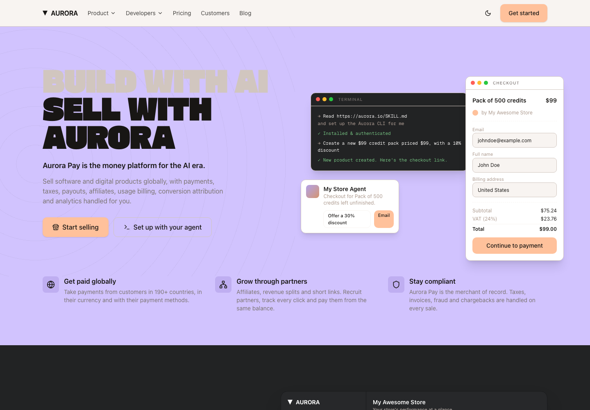

# Aurora Pay

A Next.js 15 marketing site for a developer-payments platform — the kind of
site a merchant-of-record product needs: global payments, usage billing,
affiliates and revenue splits behind one API.

Built as a production-shaped scaffold. Every mockup is a live component, the
pricing calculator is real arithmetic, and the design system is token-driven
so the whole thing restyles from one file.



---

## Features

### Payments

- **Hosted checkout** — a drop-in checkout page with product, price, currency,
  tax and VAT breakdown before payment.
- **Payment links** — a shareable link per product, with a real conversion
  funnel behind it.
- **Payment methods** — cards, PayPal, Apple Pay, Google Pay, plus local
  methods surfaced per buyer country.
- **One flat rate** — 3.9% + $0.40 per successful transaction. The same rate
  for one-time purchases and subscriptions, every card type, every country.
- **No monthly fees** — no setup fees, no minimum volume, nothing until you
  sell.

### Billing and metering

- **Credit wallets** — sell prepaid credit packs. Customers pay up front, the
  balance is debited per generation, call or minute, and auto-refill tops it
  back up.
- **Usage-based pricing** — attach a per-unit price to any product with a free
  allowance and an optional cap. Customers see their own usage; you see it per
  customer and per period.
- **Custom meters** — define the unit (tokens, images, minutes, API calls)
  with filters and aggregations, then post usage events and let the platform
  do the counting.
- **Subscriptions** — recurring billing with dunning, failed-payment recovery
  and scheduled cancellation.
- **Discounts** — percentage or fixed, one-time or reusable code.

### Global coverage

- **Merchant of record** — Aurora Pay is the legal seller on every
  transaction. You build the product; we carry the compliance.
- **Payments, tax and invoicing** — cards, PayPal, Apple Pay and Google Pay
  charged in the buyer's currency.
- **Taxes and compliance** — VAT, GST and sales tax calculated, collected,
  filed and remitted across 190+ countries.
- **Invoices, fraud and chargebacks** — a compliant invoice on every sale;
  fraud screening and chargeback liability sit with the platform.
- **Payouts** — paid out on the 1st and 15th of every month to a bank account
  or a USDC wallet.

### Growth and partners

- **Affiliates** — commission per product and per affiliate, with an approval
  step and a shared balance to pay from.
- **Revenue splits** — route a share of every sale to co-founders,
  collaborators or licensors automatically. No spreadsheet reconciliation.
- **Short links** — track every click and conversion with QR codes, password,
  geo and device targeting.
- **Conversion attribution** — see which link, affiliate or partner produced
  each sale.

### Developer-first

- **MCP server** — point an agent at the store and it creates products, opens
  checkouts and wires verified webhooks by calling the real API with your key.
- **REST API** — products, checkouts, subscriptions, meters, webhooks.
- **SDKs** — TypeScript and Python.
- **CLI** — script the whole store from a terminal or a cron job.
- **Webhooks** — signed, verified, and replayable.
- **Test mode** — build and check the whole setup on test keys, then switch to
  live payments when you are ready.

### Platform

- **Analytics** — revenue, customer and retention reporting in the dashboard.
- **Mobile apps** — iOS and Android with real-time push notifications, so
  every sale lands on your lock screen without opening a dashboard.
- **Agent monitoring** — get notified on a new sale, a failed renewal or a
  scheduled cancellation, and act on it from the same place.

---

## Getting started

The repository is pinned to Node `22.12.0` and npm `10.9.0`. A clean install
must use the committed lockfile:

```bash
nvm install             # installs the version from .nvmrc when needed
nvm use                 # selects Node 22.12.0
corepack enable         # activates the pinned npm version
npm ci                  # reproducible dependency install
cp .env.example .env.local
npm run dev             # http://localhost:3000
```

The environment file currently contains only the public site origin. It has no
secrets and can be used as-is for local development.

For a production build and local production server:

```bash
npm run build
npm run start             # http://localhost:3000
```

The single project test command runs the typecheck and production build:

```bash
npm test
```

`lightningcss` uses a platform-specific optional package. The preflight check
before `dev` and `build` accepts the correct GNU or musl package on Linux and
prints an actionable reinstall command when `node_modules` was created for a
different runtime.

### Docker

Docker provides the clean Linux build path and uses the same pinned Node
runtime as `.nvmrc`:

```bash
docker build -t aurora-pay .
docker run --rm --env-file .env.example -p 3000:3000 aurora-pay
```

Open <http://localhost:3000> after the container starts. The image does not
contain local `node_modules`, `.next` output, git metadata, or real environment
files.

## Tech stack

- **Next.js 15** App Router, React 19, TypeScript strict
- **Tailwind CSS v4** — CSS-first config. Tokens live in `app/globals.css`
  under `@theme`. There is no `tailwind.config.js`.
- **shadcn/ui** conventions (`data-slot`, semantic CSS variables) on **Radix
  UI** primitives. `button` and `accordion` are vendored in `components/ui/`;
  add more with `npx shadcn@latest add <name>`.
- **lucide-react** icons
- Fonts self-hosted via `next/font/local` from `public/fonts/`

## Design system

All colors are **OKLCH**. Semantic tokens (`--background`, `--card`,
`--border`, `--accent`, `--chart-*`) are defined for light in `:root` and dark
in `.dark`, then re-exported into Tailwind via `@theme inline`.

Three neutral ramps — `gray-*` for light surfaces, `charcoal-*` for dark — plus
`peach`, `green`, `blue`, `violet`, `amber` and `red` accents. The peach
accent carries every primary button.

### Typography

| Role | Font | Use |
| --- | --- | --- |
| Display | `gasoekOne` | Hero H1 and big statement headings only. Always uppercase, `font-weight: 400`, tight tracking, line-height ~0.95. **The strongest brand signal — do not substitute.** |
| Body | `GeistSans` | Everything else |
| Mono | `GeistMono` | Code blocks, prices, metrics, terminal mockups |

The `.font-display` utility applies the display treatment. Note that the font
family is resolved directly rather than through a CSS variable indirection —
`next/font` emits `--font-gasoek` on `<body>`, so a variable declared on
`:root` would resolve to an invalid value at computed-value time and silently
fall back to the body font.

### Theming

A small inline script in `app/layout.tsx` applies the stored theme before first
paint, so there is no flash. `components/theme-toggle.tsx` toggles `.dark` on
`<html>` and persists to `localStorage`. Append `?theme=light` or
`?theme=dark` to any URL to force a mode — handy for screenshots and QA.

## Site structure

```
/                              Home
/about                         Company story, principles, timeline and team
/pricing                       Pricing, with a live fee calculator
/cases  /blog  /careers
/contact  /book-a-call
/sign-in  /payment-fee-calculator
/comparisons/[provider]        vs Stripe, Paddle, Gumroad, Whop, …
```

Everything other than `/`, `/about` and `/pricing` is a placeholder with the
shared header and footer.

The homepage runs 16 sections in order: hero, trust row, dark statement with a
dashboard mockup, bento grid, billing, global coverage, partners, agent
onboarding, agent monitoring, mobile apps, pricing teaser, partner plan,
testimonials, FAQ, and a final call to action.

The about page runs eight: hero, stats strip, mission, principles, timeline,
team, integrations, and a closing call to action.

## Project structure

```
app/
  layout.tsx              fonts, metadata, theme script
  globals.css             design tokens + base layer
  page.tsx                home
  pricing/page.tsx        pricing
  [slug]/page.tsx         placeholder pages
  comparisons/[slug]/     comparison placeholders
components/
  mockups.tsx             every UI mockup (terminal, checkout, dashboard, …)
  sections.tsx            every homepage section
  site-header.tsx         sticky nav + mobile drawer
  site-footer.tsx         four link columns
  fee-calculator.tsx      client component, fee arithmetic
  provider-comparison-chart.tsx   SVG bar chart, no chart dependency
  theme-toggle.tsx
  ui/button.tsx           cva variants
  ui/accordion.tsx        Radix wrapper
lib/
  mock-data.ts            all content
  utils.ts                cn()
scripts/
  check-native-deps.mjs   native-dependency preflight
public/fonts/             GeistSans, GeistMono, gasoekOne (woff2)
docs/                     reference screenshots
```

## Customizing

All copy, figures, testimonials, FAQ entries and provider rates live in
`lib/mock-data.ts` — edit there, not in the components. Changing the palette
means editing `@theme` in `app/globals.css` and nothing else.

## Notes

- **No backend.** Every figure is static mock data.
- **The fee calculator** compares four providers with hardcoded rates. The
  advanced calculator compares nine-plus providers with FX and international
  surcharge modelling — not implemented here.
- **Charts are hand-rolled SVG**, not a charting library, to keep the
  dependency list short.
- **Legal pages** (`/privacy`, `/terms`, `/buyer-terms`, `/dpa`) are linked but
  not routed yet.

## Licensing

`public/fonts/gasoekOne.woff2` is a **commercially licensed typeface**.
Verify its license before shipping this publicly, or swap it for a similar
open alternative — the `.font-display` utility is the only thing that needs
to change. Geist Sans and Geist Mono are open source (SIL OFL).

All code and copy in this project is original.
